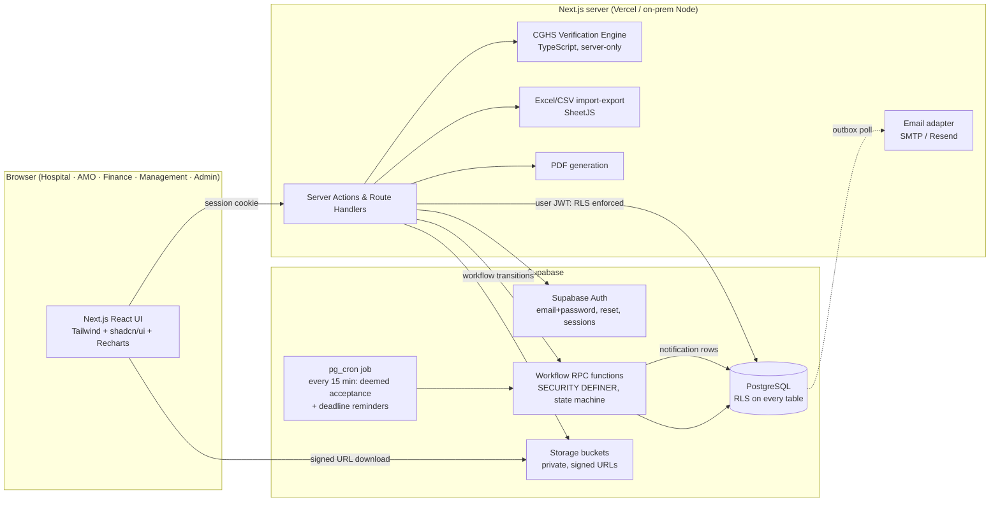
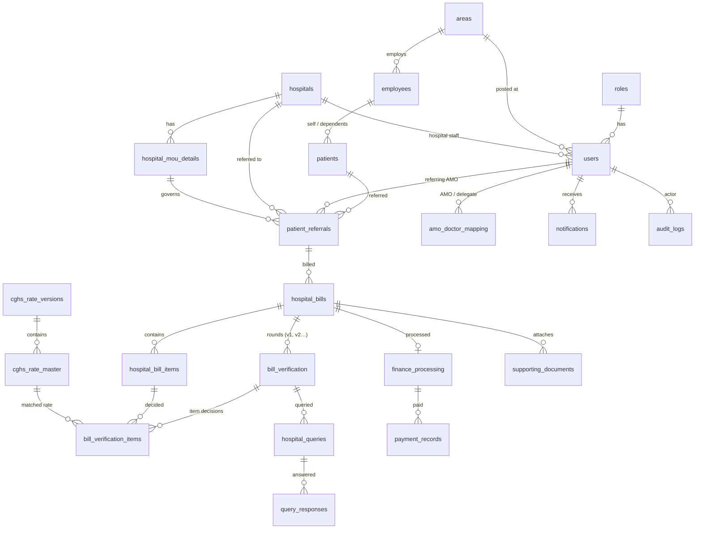

# MCL Medical Bill Management System — Requirements Analysis & Design

**Hospital Bill Verification & Reimbursement Portal**
Document status: Draft v0.1 (Phase 0 — analysis before implementation) · 27-Nov-2026

This document covers the six pre-coding items requested in the master brief (§22):
system architecture, database relationships, role/permission matrix, bill workflow,
CGHS verification logic and the 7-day automated workflow — followed by the
**open business rules and workflow conflicts** that must be settled before or during Phase 1.

---

## 1. System architecture



**Key design decisions**

| Decision | Choice | Reason |
|---|---|---|
| Where workflow rules live | Postgres functions (`rpc_submit_bill`, `rpc_send_to_hospital`, `rpc_accept_bill`, `rpc_raise_query`, `rpc_forward_to_finance` …) | A status change can't bypass the rules even if someone calls the API directly; each transition is one atomic transaction with its audit row |
| Where money is calculated | Server-only TypeScript engine, re-validated by DB constraints (`amount = qty × rate`, `admissible ≤ claimed` unless justified) | Testable, readable rule code; the browser never decides an amount |
| Who can see what | Row Level Security on every table, keyed on `auth.uid()` → `users.role` + `hospital_id` / `amo_id` | Hospital A can never read Hospital B's rows, even with a crafted request |
| 7-day timer | `pg_cron` inside the database (no frontend timers, no Vercel dependency) | Runs even if the web tier is down; idempotent single `UPDATE … WHERE status = 'SENT_TO_HOSPITAL' AND deadline < now()` |
| Email | Notification rows written in the same transaction (outbox), sent by a worker | No lost or duplicate emails when a transaction rolls back |
| Documents | Private Storage bucket, path `bills/{bill_id}/{doc_id}`, MIME + size validation, signed URLs (5 min) | No public links to patient documents |
| Secrets | Service-role key only in server environment variables; browser gets anon key only | As required in §15 |

---

## 2. Database relationship diagram



**Integrity rules enforced in the schema**

- `hospital_bills.referral_id` is `NOT NULL` + FK; a bill without a referral requires an `admin_exception_id` (separate approved-exception table).
- Unique `(referral_id, bill_type, hospital_bill_no)` prevents duplicate submissions; a unique partial index allows only one *active* final bill per referral.
- `bill_verification` is **insert-only** (`round_no` increments; an `UPDATE`/`DELETE` trigger raises an error once a round is `SUBMITTED`) — history is never overwritten (§18 rule 9–10).
- `finance_processing.bill_id` is `UNIQUE` → automatic forwarding cannot create duplicates (§18 rule 13).
- `cghs_rate_master` has `effective_from`, `effective_to`, `version_id`; an exclusion constraint prevents two active rates for the same `(code, specification, city_class)` over overlapping dates.
- `audit_logs` is append-only (no UPDATE/DELETE grant to any role, including admin through the app).
- Money columns are `numeric(14,2)`, never floating point.

---

## 3. Role & permission matrix

Legend: **C** create · **R** read · **U** update · **A** workflow action · — none. "Own" = rows linked to the user's hospital / referred patients.

| Resource / action | Admin | Hospital | AMO | Finance | Management |
|---|---|---|---|---|---|
| Users, roles, settings | C R U | — | — | — | — |
| Hospitals & MOUs | C R U | R (own) | R | R | R |
| CGHS rate master & versions | C R U (import) | R (rates only) | R | R | R |
| Employees / patients | C R U | R (own referrals) | C R (own area) | R (forwarded) | R (aggregates) |
| Patient referrals | C R U, exceptions | R (own), confirm admission | C R U (own) | R (forwarded) | R |
| Hospital bills & items | R | C R U while Draft/Revision (own) | R (own referrals) | R (forwarded) | R |
| Supporting documents | R | C R (own) | R (own) | R (forwarded) | — |
| Item-wise verification | R | R (after sent) | C U while round open (own) | R | R |
| Send verified bill to hospital | — | — | A (own) | — | — |
| Accept / raise query (7-day window) | — | A (own) | — | — | — |
| Reply to query / new round | — | — | A (own) | — | — |
| Forward to Finance | system job only | (via acceptance) | — | — | — |
| Financial scrutiny, sanction, payment | R | R (status only) | R (status only) | C U A | R |
| Modify AMO medical decision | — | — | own only | **never** (return via workflow) | — |
| Reassign AMO / delegate | A | — | — | — | — |
| Dashboards & reports | all | own | own | finance scope | all (read-only) |
| Audit log | R | own bills (timeline) | own bills | forwarded bills | R |

---

## 4. Bill workflow (state machine)

```mermaid
stateDiagram-v2
  [*] --> DRAFT: Hospital creates bill against referral
  DRAFT --> SUBMITTED: Hospital submits (totals locked, AMO notified)
  SUBMITTED --> UNDER_VERIFICATION: AMO opens / saves draft (round n)
  UNDER_VERIFICATION --> UNDER_VERIFICATION: Save as draft
  UNDER_VERIFICATION --> REVISION_REQUESTED: AMO asks hospital to correct/upload
  REVISION_REQUESTED --> SUBMITTED: Hospital resubmits (new bill version)
  UNDER_VERIFICATION --> SENT_TO_HOSPITAL: AMO submits verified bill (deadline = now + N days)
  SENT_TO_HOSPITAL --> QUERY_RAISED: Hospital raises item queries (within deadline)
  QUERY_RAISED --> UNDER_VERIFICATION: AMO reviews (round n+1)
  SENT_TO_HOSPITAL --> ACCEPTED: Hospital accepts
  SENT_TO_HOSPITAL --> DEEMED_ACCEPTED: pg_cron — deadline passed, no query
  ACCEPTED --> PENDING_FINANCE: auto (same transaction)
  DEEMED_ACCEPTED --> PENDING_FINANCE: auto (same transaction)
  PENDING_FINANCE --> FINANCE_RETURNED: Finance returns for clarification
  FINANCE_RETURNED --> UNDER_VERIFICATION: Medical point → AMO (new round)
  FINANCE_RETURNED --> PENDING_FINANCE: Document point resolved by hospital
  PENDING_FINANCE --> FINANCIALLY_APPROVED: Sanctioned amount entered
  FINANCIALLY_APPROVED --> PAYMENT_PROCESSED: Voucher / SAP doc no.
  PAYMENT_PROCESSED --> PAYMENT_COMPLETED: Payment date; hospital & AMO notified
  PAYMENT_COMPLETED --> [*]
```



Every arrow is one RPC function that (1) checks the caller's role and ownership, (2) checks the current status, (3) writes the change, (4) writes an `audit_logs` row and (5) writes `notifications` rows — all in one transaction.

---

## 5. CGHS rate verification logic

### 5.1 Matching (per bill item)

1. **Select schedule version** effective on the bill's *rate reference date* (see open question Q3) for the hospital's city class.
2. **Exact match** on `cghs_code` **and** normalised `specification` + compatible `unit` → *matched*.
3. Code matches but specification or unit differs → *manual verification* (no auto-equivalence, §6 rule 6).
4. No code → **name suggestion** (trigram similarity ≥ 0.6 via `pg_trgm`) shown as a suggestion only; AMO must confirm before it's used (§6 rule 8).
5. Nothing found → *not found* — never auto-approved (§6 rule 5).

### 5.2 Applicable ceiling

```
Applicable CGHS rate = schedule base rate
                       × city factor        (Tier I / II / III)        ┐ from system_settings
                       × accreditation      (NABH / Non-NABH)          │ or MOU overrides —
                       × super-specialty    (if MOU says so)           │ configurable, versioned,
                       × ward factor        (min(entitled, occupied))  ┘ never hardcoded
                       × (1 − MOU discount %) if the MOU has one
Admissible amount      = admissible qty × admissible rate
Excess                 = claimed amount − admissible amount
```

Plus structural rules from the earlier scrutiny prototype (`js/engine.js`, to be ported):
- **Room rent** limited to entitled ward rate × chargeable days (stay days − package days).
- **Package inclusion**: investigations, medicines, consumables and visits during a package period are flagged *"included in package"* unless the AMO marks them as complication/beyond-package.
- **Implants** at the ceiling price; not scaled.
- **Non-admissible keyword list** (toiletries, attendant charges, registration, admin charges…) → suggested disallow, AMO confirms with reason.
- **Quantity sanity checks**: room/ICU days > stay, duplicate item (same code+spec+date), the same investigation repeated on the same day → yellow.

### 5.3 Colour status (shown on every line)

| Colour | Condition | Default proposal | AMO action needed |
|---|---|---|---|
| 🟢 Green | Matched, claimed rate ≤ ceiling | admissible = claimed | One click (bulk "approve all green") |
| 🔴 Red | Matched, claimed rate > ceiling | admissible = ceiling, excess flagged | Confirm or override with remark |
| 🟡 Yellow | Spec/unit mismatch, name-suggestion only, package conflict, quantity anomaly, non-admissible keyword | admissible = 0 until decided | Must decide |
| ⚪ Grey | No CGHS rate found | admissible = 0 until decided | Must decide |

The AMO can't submit a round while any yellow or grey item is undecided. A remark is mandatory for every *disallow* and every *override* (`CHECK` constraint plus UI validation). Each override writes an audit row with the old and new value.

---

## 6. Seven-day automated query workflow

```mermaid
sequenceDiagram
  participant AMO
  participant DB as Postgres (RPC + pg_cron)
  participant H as Hospital
  participant F as Finance
  AMO->>DB: rpc_send_to_hospital(bill, round n)
  DB->>DB: sent_at = now(); deadline = end of day IST (sent_at + N days)
  DB-->>H: notification + email "Verified bill received, reply by <deadline>"
  Note over DB: pg_cron every 15 min
  DB-->>H: reminder at deadline − 48 h and − 24 h (once each, flags prevent repeats)
  alt Hospital accepts
    H->>DB: rpc_accept_bill
    DB->>F: status PENDING_FINANCE, finance_processing row (UNIQUE bill_id)
  else Hospital raises query before deadline
    H->>DB: rpc_raise_query(items, reasons, docs)
    DB-->>AMO: query notification; status QUERY_RAISED
    AMO->>DB: responses + new round n+1 → rpc_send_to_hospital (new deadline)
  else Deadline passes, no response
    DB->>DB: UPDATE … SET status='DEEMED_ACCEPTED' WHERE status='SENT_TO_HOSPITAL' AND deadline < now() RETURNING id
    DB->>F: INSERT finance_processing … ON CONFLICT (bill_id) DO NOTHING
    DB->>DB: audit_logs actor = 'SYSTEM'
  end
```

- The query period N is in `system_settings` (default 7 calendar days), and each round stores the value used at the time.
- A query RPC rejects any call after `deadline` (server time) — the UI countdown is only for display.
- Idempotency: the status guard in `WHERE` + `UNIQUE(bill_id)` on finance rows means re-running the job can't double-forward.

---

## 7. Open business rules & workflow conflicts (decisions needed)

These are gaps or tensions in the brief. Each has a **recommended default** so development can continue, but MCL's Medical and Finance departments should confirm them.

| # | Issue | Why it matters | Recommended default |
|---|---|---|---|
| Q1 | **Medicines have no CGHS rate list.** CGHS publishes package/procedure/investigation rates, not drug prices. | With "not found ⇒ manual" all 20 demo medicines would be grey. | Admin uploads a separate *Medicine price schedule* (NPPA ceiling price / MRP / MOU drug discount) as its own rate version type; medicines are checked against it, otherwise manual |
| Q2 | **"Admissible rate = CGHS rate" is too simple.** CGHS rates vary by NABH status, city tier, ward entitlement and super-specialty; MOUs may also give a discount on CGHS. | Wrong ceiling → wrong payment. | Rule factors stored in settings and per-MOU overrides (§5.2), all versioned |
| Q3 | **Which date picks the rate version?** | Rates are revised mid-year. | Date of admission (falls back to referral date) |
| Q4 | **Exact 7-day deadline.** Is it 7×24 h from sending, or end of the 7th calendar day? | Disputes at the boundary. | End of the 7th calendar day, 23:59:59 IST; weekends and holidays are counted |
| Q5 | **Unlimited query rounds.** | A bill could cycle forever. | No hard cap; after round 3 the bill is flagged to a supervisory authority (CMO/CMS) on the management dashboard |
| Q6 | **Partial acceptance.** Can a hospital accept some items and dispute others? | Changes whether a bill can be paid partly. | No — a query returns the whole bill; the undisputed items stay as decided and carry forward |
| Q7 | **Finance "Returned for Clarification" — to whom?** Finance must not change medical decisions. | Needs two return paths. | Finance chooses *medical point → AMO (new round)* or *document point → hospital*; neither path lets Finance change any amount |
| Q8 | **Sanctioned amount vs admissible amount.** | TDS, advances or recoveries can make the payment differ. | Sanctioned ≤ final admissible; deductions (TDS, advance adjustment, recovery) are separate lines with reasons; any difference needs a remark |
| Q9 | **AMO transfer, leave or absence.** | Bills stuck with an absent AMO. | Admin can reassign or delegate through `amo_doctor_mapping` with validity dates; delegated actions are logged under both names |
| Q10 | **Emergency or non-referred admissions.** | The brief forbids bills without a referral. | Admin creates an *exception referral* (flagged); it follows the normal workflow afterwards |
| Q11 | **Interim vs final bills.** | Long stays often have interim bills. | Allow `bill_type` = Interim / Final / Supplementary; duplicate-item detection works across all of a referral's bills |
| Q12 | **Hospital edits after submission.** | The audit trail requires it. | Locked after submit; changes only through a *Revision requested* path that creates a new bill version |
| Q13 | **Hosting & data residency.** Vercel + Supabase cloud puts patient data on third-party servers. | DPDP Act 2023 and PSU IT policy. | Supabase region Mumbai (ap-south-1) for the pilot; the same code runs on self-hosted Supabase plus an on-prem Node server if MCL IT requires it |
| Q14 | **Email provider.** | Needs credentials and DNS. | Pluggable adapter; SMTP (MCL mail server) or Resend; in-app notifications work without email |
| Q15 | **Supervisory medical role** (CMO/CMS approving above a threshold). | Not in the brief, common in PSUs. | Not built initially; the role model allows it to be added |

---

## 8. Phase plan (as per brief §19)

| Phase | Scope | Exit check |
|---|---|---|
| 1 Foundation | Next.js + TS + Tailwind + shadcn setup; Supabase schema migrations; auth; roles; user, hospital and MOU admin | Five demo users log in and see only their role's menu; RLS tests pass |
| 2 Referrals | Employees, patients, referrals, AMO mapping, referral letter upload | A hospital sees only referrals made to it |
| 3 Hospital billing | Item-wise entry, Excel import, documents, automatic totals, submission | Demo bill of ₹2,50,000 (20 meds + 5 inv + 3 proc) submitted |
| 4 CGHS verification | Rate versions, CSV/Excel import, matching engine, AMO screen | 6 red items flagged; AMO arrives at ₹2,10,000 |
| 5 Queries | Accept/query, rounds, pg_cron deadline job, reminders | Query → round 2 → acceptance; deemed-acceptance job tested |
| 6 Finance | Forwarding, scrutiny, sanction, voucher/SAP, payment | Status reaches Payment Completed |
| 7 Analytics | Management dashboard, charts, filters, Excel/PDF exports, audit report | Figures reconcile with the bill data |
| 8 Test & deploy | E2E (Playwright) across four roles, RLS security tests, deployment docs | Full demo scenario runs end to end |

## 9. Prerequisites on the development machine

None of these are installed at present:

- Node.js 20 LTS or newer (includes npm)
- Git
- Supabase: either a cloud project (free tier is enough for development) or Docker Desktop for a local Supabase stack
- (Later) An email provider account for notifications
